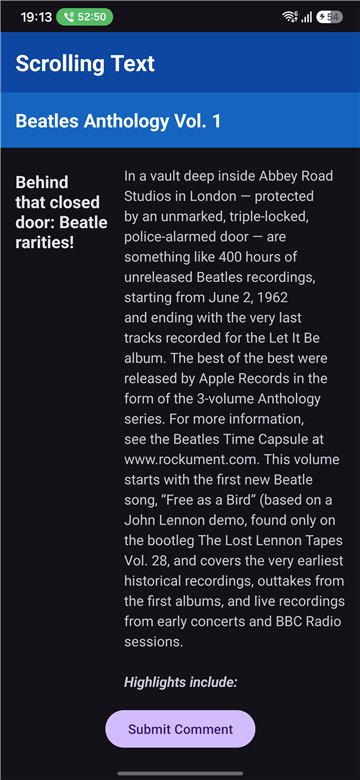

# ScrollView Android Application

An Android application demonstrating scrollable layouts, multi-column UI structures, and theme-adaptive text formatting in native Android Views.

> [!NOTE]
> This application was created as part of the **Razvoj mobilnih aplikacij - Naloga 4** coursework ("Delo z besedilom in drsnim pogledom").

---

## Features

- **Header Banners:** Fixed top header title (`Scrolling Text`) and article title banner (`Beatles Anthology Vol. 1`) formatted using adaptive theme colors.
- **Two-Column Scrollable Layout:** A vertical `ScrollView` containing a horizontal `LinearLayout` divided into two responsive columns:
  - **Left Column (Subtitle):** Width fixed at `100dp` to force text wrapping (`Behind that closed door: Beatle rarities!`).
  - **Right Column (Main Article):** Fills the remaining screen width (`layout_weight="1"`) with HTML-formatted highlights and line spacing for enhanced readability.
- **Interactive Action Button:** Anchored at the d-bottom of the layout; tapping triggers a `Toast` notification displaying `"Comment submitted!"`.
- **Light & Dark Theme Compatibility:** Utilizes dynamic theme attributes (`?android:attr/textColorPrimary` & `?android:attr/textColorSecondary`) and night-mode resource qualifiers (`res/values-night/colors.xml`) for contrast in both Light and Dark system modes.

---

## Screenshot



---

## Layout Hierarchy

```
ConstraintLayout (root)
 ├── TextView (title_scrolling_text)
 ├── TextView (subtitle_beatles_anthology)
 ├── ScrollView
 │    └── LinearLayout (orientation="horizontal", padding="16dp")
 │         ├── TextView (width="100dp", subtitle_rarities)
 │         └── TextView (width="0dp", weight="1", article_content)
 └── Button (buttonComment, anchored to bottom)
```

> [!TIP]
> `ScrollView` requires exactly **one** direct child view. Using a horizontal `LinearLayout` inside `ScrollView` allows multi-column layouts to scroll smoothly as a single unit.

---

## Key Files

- [activity_main.xml](file:///C:/Users/domen/AndroidStudioProjects/ScrollView/app/src/main/res/layout/activity_main.xml) — XML layout definition with ConstraintLayout, ScrollView, and horizontal LinearLayout.
- [MainActivity.java](file:///C:/Users/domen/AndroidStudioProjects/ScrollView/app/src/main/java/com/domenkoder/scrollview/MainActivity.java) — Activity implementation handling HTML text rendering and Toast button click listener.
- [strings.xml](file:///C:/Users/domen/AndroidStudioProjects/ScrollView/app/src/main/res/values/strings.xml) — Centralized string resource repository.
- [colors.xml](file:///C:/Users/domen/AndroidStudioProjects/ScrollView/app/src/main/res/values/colors.xml) & [colors-night/colors.xml](file:///C:/Users/domen/AndroidStudioProjects/ScrollView/app/src/main/res/values-night/colors.xml) — Theme-aware color resources for Light and Dark modes.

---

## How to Build & Run

1. Open the project in **Android Studio**.
2. Build the app using Gradle: `./gradlew app:assembleDebug` or via IDE **Run** / **Deploy**.
3. Deploy to an Android emulator or physical device running Android 7.0 (API 24) or higher.
